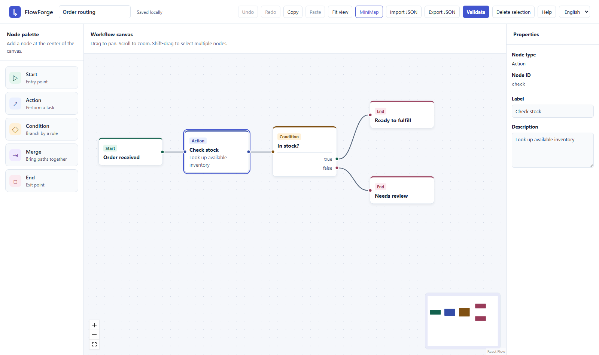
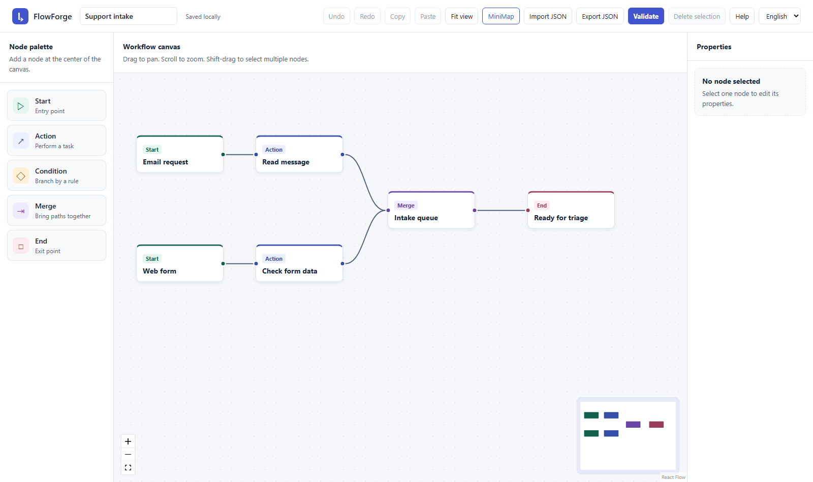
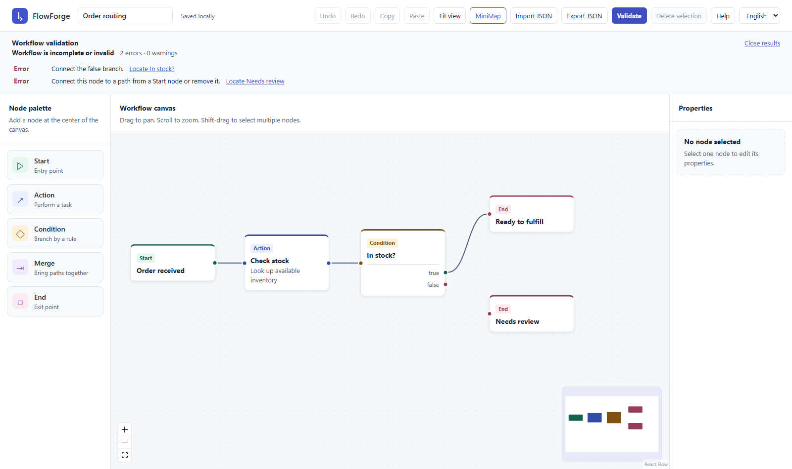
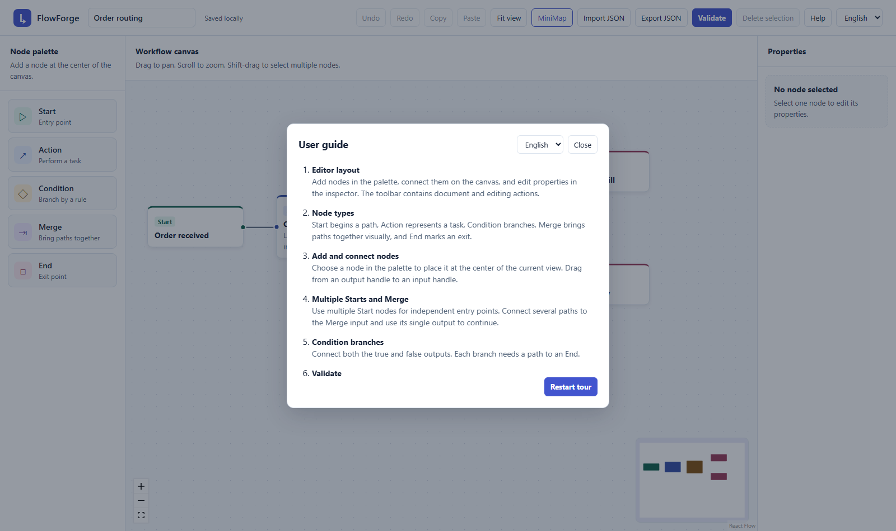

# FlowForge

[English](README.md)

## 프로젝트 소개

FlowForge는 브라우저에서 워크플로를 그리는 편집기입니다. 노드와 연결을 배치하고 그래프 구조를 검증하며, 편집 가능한 초안을 JSON으로 공유할 수 있습니다. 별도 백엔드 없이 실행됩니다.

## 미리보기

[라이브 데모](https://flowforge-editor.vercel.app/)



| 여러 Start와 Merge                                                            | 검증 결과                                                       | 사용자 가이드                                                 |
| ----------------------------------------------------------------------------- | --------------------------------------------------------------- | ------------------------------------------------------------- |
|  |  |  |

## 주요 기능

- Start, Action, Condition, Merge, End로 흐름을 구성합니다. 여러 Start의 독립 경로를 Merge에서 시각적으로 합칠 수 있습니다.
- 노드 속성을 편집하고, 다중 선택으로 이동·삭제·복사·붙여넣기와 실행 취소·다시 실행을 사용합니다.
- 핸들 규칙, 순환, 필수 출력, Start에서의 도달 여부, End로의 종료 경로를 검사합니다.
- 브라우저 오리진당 로컬 초안 한 개를 자동 저장하고, 뷰포트를 복원하며, 버전이 있는 JSON을 가져오고 내보냅니다.
- 미니맵, 패닝, 확대·축소, 전체 보기로 캔버스를 탐색합니다.
- 한국어와 영어를 전환할 수 있으며, 도움말에서 사용자 가이드와 5단계 둘러보기를 이용할 수 있습니다.

## 아키텍처

React Flow는 캔버스를 렌더링하고 Zustand는 편집 상태를 관리합니다. 순수 함수로 그래프 규칙을 검사하며, 저장 경계에서 Zod로 문서 형식을 검증합니다. [아키텍처](docs/architecture.md)와 [문서 형식](docs/data-model.md)을 참고하세요.

## 시작하기

Node.js 24와 npm을 사용합니다.

```sh
npm ci
npm run dev
```

Vite가 표시하는 주소를 엽니다. 기본 언어는 한국어이며 툴바와 첫 방문 둘러보기에서 영어로 전환할 수 있습니다.

## 사용 방법

1. 팔레트에서 노드를 추가하고 출력 핸들을 입력 핸들에 연결합니다. Condition의 `true`와 `false`는 각각 연결합니다.
2. 노드 하나를 선택해 이름과 설명을 수정합니다. Ctrl/Cmd를 누른 채 클릭하거나 Shift를 누른 채 드래그하면 여러 노드를 선택할 수 있습니다.
3. **검증**을 실행하고 문제 항목의 **위치로 이동** 버튼으로 해당 노드를 찾습니다.
4. 툴바에서 워크플로 이름을 편집합니다. Enter를 누르거나 포커스를 옮기면 저장되고, Escape로 취소할 수 있습니다.
5. **JSON 내보내기**로 사본을 만듭니다. 파일을 가져올 때는 형식을 검사하고 현재 초안의 교체를 확인합니다.

캔버스에 포커스가 있으면 Ctrl/Cmd+Z로 실행 취소, Ctrl/Cmd+Shift+Z 또는 Ctrl+Y로 다시 실행, Ctrl/Cmd+C 또는 V로 복사·붙여넣기, Ctrl/Cmd+A로 전체 선택, Delete 또는 Backspace로 삭제, Ctrl/Cmd+0으로 전체 보기를 사용할 수 있습니다. 텍스트 입력란에서는 기본 단축키가 동작합니다.

로컬 초안을 복원할 수 없으면 교체를 확인할 때까지 기존 저장 데이터를 보존합니다.

## 캔버스에서 편집

노드를 하나 이상 선택하면 플로팅 툴바에서 복사, 복제, 삭제, 더 많은 작업을 사용할 수 있습니다. 노드나 그룹을 우클릭하면 해당 작업 메뉴가 열리고, 연결선을 우클릭하면 연결을 삭제할 수 있습니다. 빈 캔버스를 우클릭하면 클릭한 위치에 붙여넣거나 전체 선택, 실행 취소, 다시 실행, 화면에 맞추기를 실행할 수 있습니다. 캔버스, 노드 또는 연결에 포커스가 있을 때 Shift+F10으로도 메뉴를 열 수 있습니다.

## 워크플로 시뮬레이션

각 출력을 End로 이어지는 경로에 연결합니다. Condition을 더블 클릭해 비교할 항목, 비교 기호, 기준값의 자료형을 선택하세요. 예를 들어 `주문 금액 ≥ 100,000`을 저장한 뒤 시뮬레이터 양식에서 `150000`을 입력하면 `true` 출력을 따라갑니다. 양식 항목은 저장된 조건에 맞춰 자동으로 표시됩니다. JSON 모드에서는 **JSON 적용**을 눌러 초안을 반영하세요. 기준값은 워크플로에 저장되며 테스트 입력은 현재 편집 세션에 유지됩니다.

Start를 고른 뒤 **시뮬레이션 시작**을 누르세요. **한 단계 실행**으로 노드를 하나씩 실행하거나 **자동 실행**으로 선택한 속도에 맞춰 진행할 수 있습니다. **일시 정지**, **재개**, **중지**, **초기화**로 세션을 제어합니다. 로그 항목을 선택하면 해당 노드로 이동합니다. 세션을 완료하거나 중지·초기화하면 편집할 수 있습니다.

## 테스트

```sh
npm run typecheck
npm run lint
npm run format:check
npm test
npm run test:coverage
npm run build
npx playwright install chromium
npm run test:e2e
```

Phase 7.6 검증에서 Vitest 101개와 Playwright Chromium 16개가 통과했습니다. 설정된 모듈의 V8 커버리지는 구문 92.86%, 분기 87.37%, 함수 97.48%, 줄 96.14%입니다.

## 기술적 결정

- 그래프 검증을 React 및 저장소와 분리해 미완성 초안도 저장할 수 있습니다.
- 문서 필드만 저장합니다. 편집 이력은 메모리에 유지하고 붙여넣을 때 ID와 연결을 다시 매핑합니다.
- 브라우저 시뮬레이터는 Start 하나에서 출발해 도달한 Merge를 통과합니다. Action은 가상 실행 이벤트를 기록합니다.
