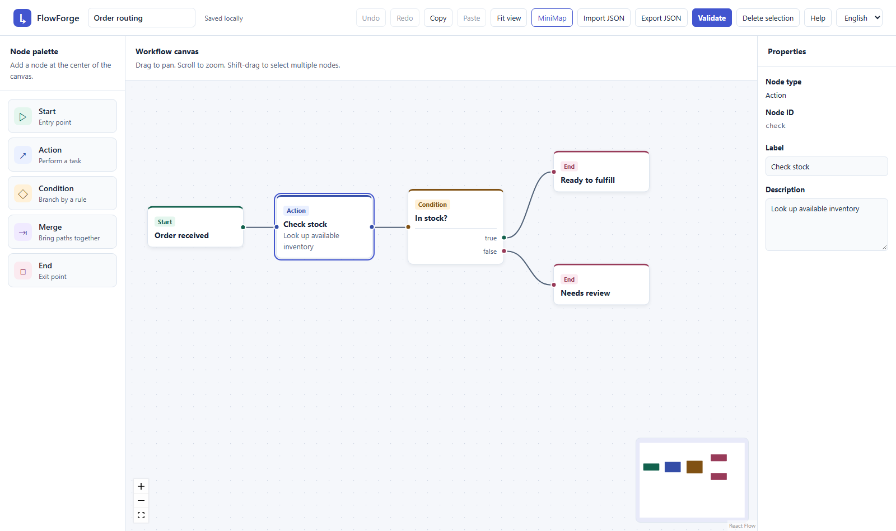
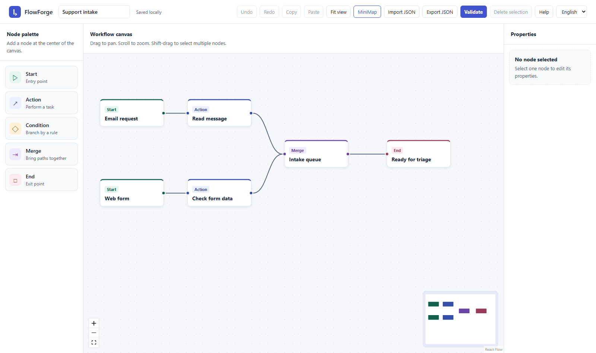
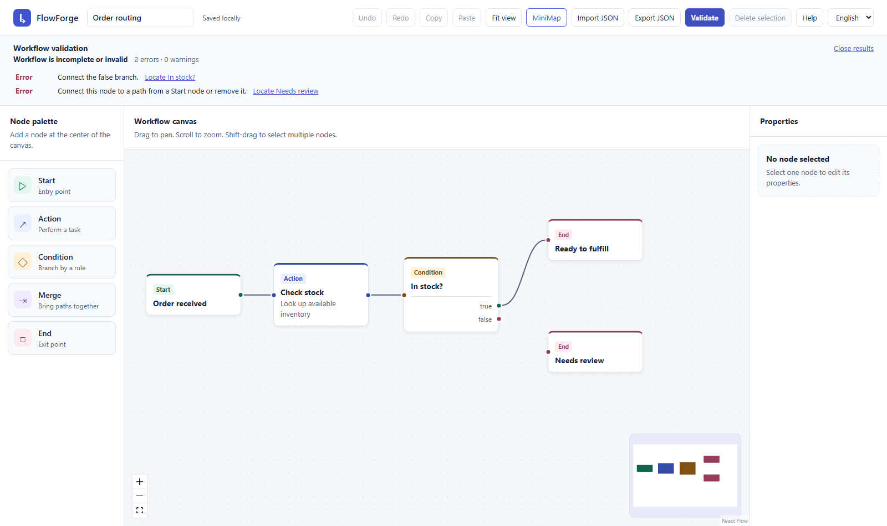
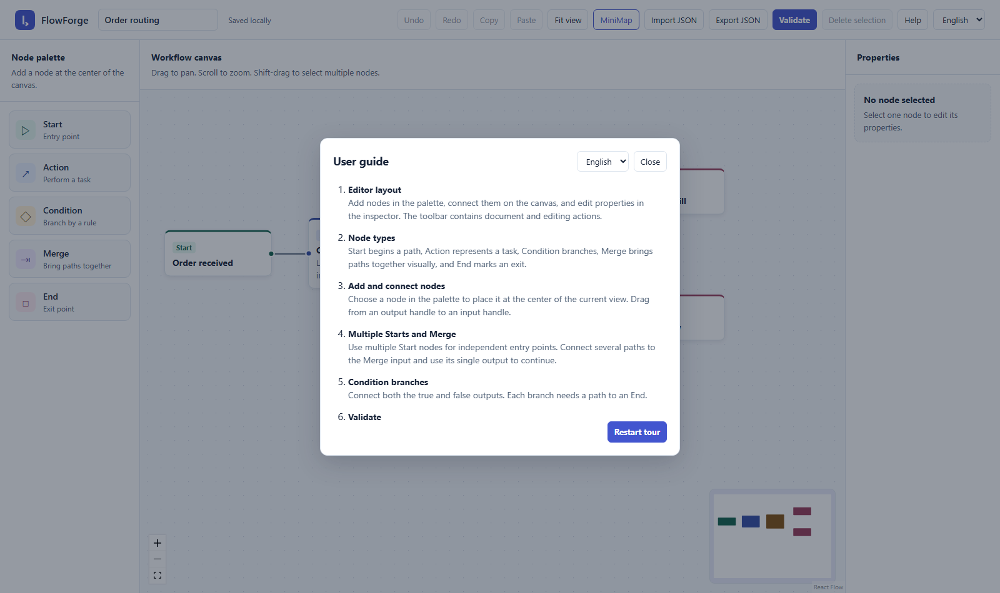

# FlowForge

[한국어](README.ko.md)

## Project overview

FlowForge is a browser-based visual workflow editor. Arrange nodes, validate the graph, and share editable JSON drafts without a backend.

## Preview

[Live demo](https://flowforge-editor.vercel.app/)



| Multi-Start and Merge                                             | Validation results                                                 | User guide                                              |
| ----------------------------------------------------------------- | ------------------------------------------------------------------ | ------------------------------------------------------- |
|  |  |  |

## Features

- Start, Action, Condition, Merge, and End nodes. Multiple Start paths can converge at Merge.
- Property editing, multi-selection, copy and paste, and undo and redo.
- Validation for handles, cycles, required outputs, reachability, and paths to End.
- Autosave one draft per browser origin, restore its viewport, and import or export versioned JSON.
- Minimap, pan, zoom, and Fit view.
- Korean and English UI, a user guide, and a five-step tour.

## Architecture

React Flow renders the canvas, Zustand manages editor state, and pure functions validate the graph. Zod checks the document format at the storage boundary. See [Architecture](docs/architecture.md) and [Document format](docs/data-model.md).

## Getting started

Use Node.js 24 and npm.

```sh
npm ci
npm run dev
```

Open the URL printed by Vite. The editor starts in Korean. Switch to English in the toolbar or the first-visit tour.

## Usage

1. Add nodes from the palette and connect output handles to inputs. Connect both `true` and `false` outputs on a Condition.
2. Select a node to edit its name and description. Use Ctrl/Cmd-click or Shift-drag for multi-selection.
3. Run **Validate** and use **Locate** to jump to a node with an issue.
4. Rename the workflow in the toolbar. Press Enter or leave the field to save, or press Escape to cancel.
5. Use **Export JSON** to save a copy. Import validates the file and confirms replacement.

Canvas shortcuts include Ctrl/Cmd+Z for undo, Ctrl/Cmd+Shift+Z or Ctrl+Y for redo, Ctrl/Cmd+C or V for copy or paste, Ctrl/Cmd+A to select all, Delete or Backspace to delete, and Ctrl/Cmd+0 to fit. Text fields keep their native shortcuts.

If a local draft fails to restore, the editor keeps it until you confirm replacement.

## Edit from the canvas

Select one or more nodes to use Copy, Duplicate, Delete, and More in the floating toolbar. Right-click a node or group for contextual actions, or right-click a connection to delete it. Right-click empty canvas for Paste at the pointer, Select all, Undo, Redo, and Fit view. With the canvas, a node, or a connection focused, press Shift+F10 to open its menu.

## Simulate a workflow

Connect each output to a path that ends at an End node. Double-click a Condition to choose an item, a comparison symbol, and a typed reference value. For example, save `Order total ≥ 100,000`, then enter `150000` in the simulator form to take the `true` output. The form lists the saved items automatically. Switch to JSON and select **Apply JSON** to use a draft. The reference remains part of the workflow, while the test input lasts for the current editor session.

Choose a Start and select **Start simulation**. Use **Step** to execute one node or **Run** to advance automatically at the selected speed. **Pause**, **Resume**, **Stop** and **Reset** control the session. Choose a log entry to locate its node on the canvas. Editing resumes when the session finishes, stops or resets.

## Testing

```sh
npm run typecheck
npm run lint
npm run format:check
npm test
npm run test:coverage
npm run build
npx playwright install chromium
npm run test:e2e
```

Phase 7.6 verification passed 101 Vitest tests and 16 Playwright Chromium tests. V8 coverage for the configured modules was 92.86% statements, 87.37% branches, 97.48% functions and 96.14% lines.

## Technical decisions

- Document validation is separate from graph validation, so incomplete drafts can be saved.
- Storage keeps document fields only. History stays in memory, and paste remaps IDs and connections.
- The browser simulator follows a single Start and passes through Merge on arrival. Action nodes record a simulated event.
